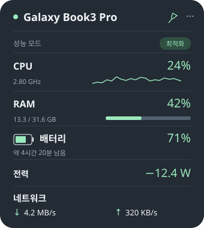

# Galaxy Book Widget

Galaxy Book3 Pro를 위한 작은 Windows 데스크톱 위젯입니다. 차콜 배경과 민트색 포인트로 CPU, 메모리, 배터리, 전력, 네트워크 상태를 표시합니다. 실제로 수집할 수 없는 항목은 화면에서 숨깁니다.



*미리보기의 수치는 문서용 예시입니다.*

## 기능

- CPU 사용률, 현재 주파수와 최근 사용률 그래프
- RAM 사용률과 사용 중 / 전체 용량
- 배터리 잔량, 충전 상태와 예상 남은 사용 시간
- `전력 +24.0 W` / `전력 −18.4 W`로 배터리 충·방전 표시
- 실시간 다운로드·업로드 속도
- 지원되는 Samsung Settings 버전에서 성능 모드 표시
- 제목 드래그로 이동, 항상 위에 표시, 크기·갱신 간격 조절
- 선택적인 로그인 자동 실행과 로컬 센서 연결

브라우저 엔진이나 클라우드 서버 없이 Python, Tkinter, Windows API로 동작합니다.

## 설치

Windows 10/11의 64비트 Python이 필요합니다. Python 3.13에서 검증했습니다. Tkinter가 포함된 [python.org Windows 설치본](https://www.python.org/downloads/windows/)을 사용할 수 있습니다.

저장소를 내려받은 뒤 프로젝트 폴더의 PowerShell에서 실행하세요.

```powershell
py -3 -m venv .venv
.\.venv\Scripts\python.exe -m pip install -r requirements.txt
.\.venv\Scripts\pythonw.exe widget.py
```

설치 후에는 `Launch.vbs`를 더블 클릭해도 됩니다. 실행기는 프로젝트의 `.venv`를 먼저 찾고, 없으면 등록된 Python을 확인합니다. VBScript가 비활성화된 Windows에서는 위의 `pythonw.exe` 명령을 사용하세요.

중복 실행하면 새 위젯을 만들지 않고 기존 창을 표시합니다.

## 사용

| 조작 | 동작 |
| --- | --- |
| 제목 드래그 | 위젯 이동, 위치 저장 |
| 핀 아이콘 | 항상 위에 표시 전환 |
| `···` 또는 오른쪽 클릭 | 크기, 갱신 간격, 센서 연결, 종료 |
| 갱신 간격 | 기본 2초, 선택 5초 |

기본 크기는 85%로, 너비 289 논리 픽셀입니다. 메뉴에서 90%, 100%(340픽셀) 이상으로 키울 수 있습니다. 세로 여백을 줄였으며 높이는 지원 항목에 맞춰 조절됩니다. Windows 화면 배율을 따릅니다. 배터리 예상 시간은 `약 2시간 15분 남음`처럼 표시합니다.

CPU 80% 이상, RAM 85% 이상이면 수치와 그래프·막대가 빨간색으로 바뀝니다. 배터리는 잔량 20% 이하일 때만 빨간색으로 표시합니다. 충·방전 전력은 색 판단에 사용하지 않습니다. 경계값 부근의 색 전환을 줄이기 위해 CPU 70% 이하, RAM 80% 이하, 잔량 25% 이상에서 각 경고를 해제합니다. 이 기준은 위젯의 표시 기준이며 하드웨어 위험 한계값이 아닙니다.

창 이동은 Windows의 기본 이동 처리를 사용합니다. 투명색 창 대신 둥근 영역으로 잘라낸 불투명 창을 사용하고, 드래그 중 데이터 화면을 다시 그리지 않아 이동 중 잔상과 깜빡임을 줄입니다. 외곽 테두리 없이 배경을 채우고 내부 구분선만 은은하게 표시합니다.

### 로그인 시 자동 실행

원하는 경우에만 아래 명령으로 현재 Windows 사용자에게 등록합니다. 관리자 권한은 필요하지 않습니다. 등록 후에는 프로젝트 폴더와 가상환경을 같은 위치에 유지하세요.

```powershell
.\.venv\Scripts\python.exe startup.py --install
```

확인과 해제:

```powershell
.\.venv\Scripts\python.exe startup.py --status
.\.venv\Scripts\python.exe startup.py --remove
```

`startup.py`는 현재 사용자의 Run 키에서 이 위젯의 항목만 관리합니다. 별도로 시작프로그램 바로가기를 만든 경우에는 그 바로가기도 따로 관리해야 합니다.

## 수집 주기와 부하

CPU·주파수·RAM·네트워크는 기본 2초마다 읽습니다. 배터리·전력·삼성 성능 모드는 최소 5초 간격으로 캐시하므로 기본 설정에서는 약 6초마다 읽습니다.

수집 연결을 유지하고, 매 갱신마다 PowerShell을 실행하거나 전체 센서를 탐색하지 않습니다. CPU 그래프는 최근 40개 샘플만 유지하며, 화면 꺼짐·절전 알림을 받으면 수집을 멈춥니다.

한 개발 환경에서 위젯 전체의 12초 측정값은 전체 CPU 평균 약 0.05%, 메모리 약 56MB였습니다. 짧은 참고 측정이며 하드웨어·드라이버·배율·선택 센서에 따라 달라집니다.

## 데이터 해석과 제한

- **전력:** 배터리에 들어가거나 배터리에서 나가는 순전력입니다. 충전기 입력 전력이나 AC 연결 중 노트북 전체 소비 전력과 다릅니다.
- **남은 시간:** 최근 최대 90초의 방전 전력을 시간 가중 평균해 계산하며, 표시는 30초 간격으로 갱신합니다. 시작 후 유효한 표본이 3개 이상, 최소 10초 모인 뒤 표시합니다. 충전 전환·30초 초과 수집 공백·데이터 소스 변경 때는 초기화합니다. 배터리 전력 데이터가 없으면 유효한 Windows 예상 시간을 같은 방식으로 완만하게 반영합니다. 계산할 수 없으면 문구를 숨기며, 추정값이라는 뜻으로 `약`을 붙입니다.
- **CPU 주파수:** Windows `Actual Frequency` 카운터의 전체 평균입니다. 작업 관리자와 집계 방식이 다를 수 있습니다.
- **삼성 성능 모드:** Samsung Settings의 저장된 설정값을 읽습니다. 앱·드라이버 버전에 따라 제공 여부와 변경 반영이 달라질 수 있습니다.
- **네트워크:** 활성 인터페이스를 합산하고 일반적인 가상·터널 인터페이스 이름을 제외합니다. VPN이나 특수 어댑터에서는 집계가 다를 수 있습니다.
- **미지원 센서:** 처음부터 제공되지 않는 항목은 숨깁니다. 한 번 수집된 항목의 일시적인 실패는 위치를 유지하고 `—`로 표시합니다. 오래된 값을 현재 값처럼 표시하지 않습니다.

### 선택 센서

이미 설치된 [Libre Hardware Monitor](https://github.com/LibreHardwareMonitor/LibreHardwareMonitor)의 로컬 웹 서버가 `127.0.0.1:8085`에서 동작하면, 위젯 메뉴의 **센서 연결 안내**에서 연결할 수 있습니다. 프로그램 버전에 따라 웹 서버 메뉴와 제공 데이터가 다를 수 있습니다.

지원되는 CPU 온도, CPU 패키지 전력, 팬 RPM을 읽습니다. 위젯이 센서 드라이버나 다른 프로그램을 자동으로 설치하지는 않습니다. 드라이버·관리자 권한이 필요할 수 있으며, 모든 갤럭시북 모델에서 센서 수집이 보장되는 것은 아닙니다.

팬의 정지·저속·중속·고속은 위젯 자체의 표시 기준입니다. 삼성 성능 모드와 별개입니다.

| 표시 | RPM |
| --- | --- |
| 정지 | 0 |
| 저속 | 1–2,499 |
| 중속 | 2,500–3,999 |
| 고속 | 4,000 이상 |

## 개인정보와 로컬 파일

외부 분석·계정·원격 데이터 전송 기능은 없습니다. 선택 센서 연결은 고정된 루프백 주소만 사용하며 프록시와 리다이렉트를 따르지 않습니다.

위치·크기 등의 설정은 로컬 `settings.json`, 오류는 크기를 제한한 `widget.log`에 저장합니다. 설정, 로그, 가상환경과 개인 바로가기는 `.gitignore`에서 제외합니다. 공유하는 로그에는 개인 파일 경로가 포함될 수 있으니 확인하세요.

## 개발과 검사

```powershell
.\.venv\Scripts\python.exe -m unittest discover -v
.\.venv\Scripts\python.exe telemetry.py --probe
```

검사는 누락값, 비정상 배터리 시간, 충·방전 부호, 센서 데이터 파싱과 자동 실행 등록 동작을 다룹니다. 자동 실행 검사에서는 레지스트리를 모킹하며 실제 로그인 설정을 변경하지 않습니다. `--probe`는 현재 장치의 읽기 전용 수집 결과를 출력합니다.

| 파일 | 역할 |
| --- | --- |
| `widget.py` | 화면, 창 조작과 수집 스레드 |
| `telemetry.py` | Windows API, 배터리 IOCTL, 성능 카운터와 선택 센서 |
| `startup.py` | 선택적인 사용자 로그인 자동 실행 |
| `Launch.vbs` | 콘솔 창 없는 실행기 |
